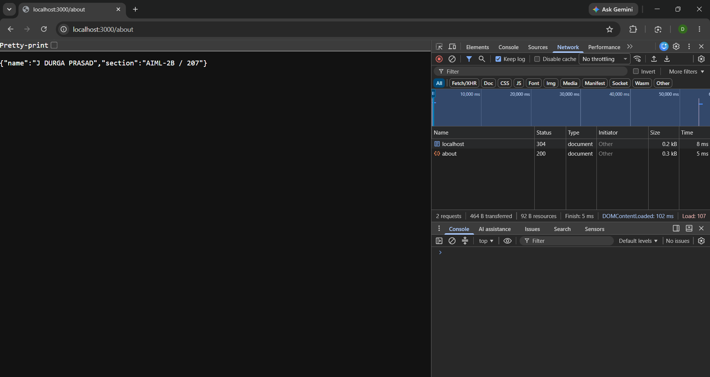
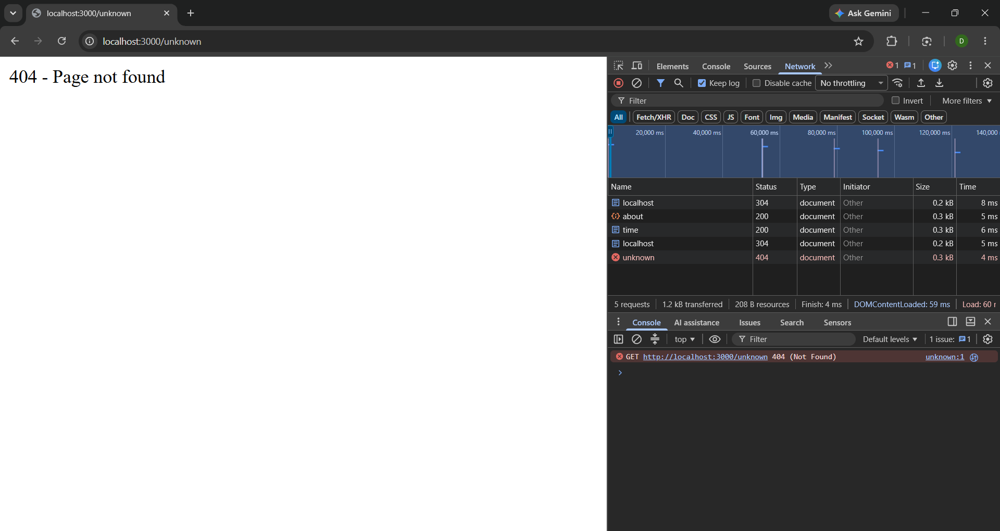

# Lab 1: Node.js and Express server

**Name:** Jella Durga Prasad 
**Registration number:** 252U1R6101
**Section:** AIML-2B / 207 

## Live link
Not deployed yet. If deployment is not possible, explain why here and include Postman screenshots of every endpoint. If deployed, replace this text with your public URL.

## Objective
Create a basic server using Node.js built-in `http` module, then create an Express server with three GET routes and a 404 response for unknown paths.

## How to install and run
1. Install Node.js and npm.
2. Open a terminal in this `lab-01` folder.
3. Install dependencies:

   ```bash
   npm install
   ```

4. Start the Express server:

   ```bash
   npm start
   ```

5. Open `http://localhost:3000` in your browser.

To run the plain Node.js HTTP server instead, stop the Express server with `Ctrl + C`, then run:

```bash
npm run start:plain
```

No environment variables are required for this lab.

## Endpoints

| Method | Path | Description | Expected status |
|---|---|---|---|
| GET | `/` | Returns a welcome message | 200 |
| GET | `/about` | Returns name and section as JSON | 200 |
| GET | `/time` | Returns the current date and time | 200 |
| GET | Any unknown path | Returns a not-found message | 404 |

## Screenshots

Add your own screenshots in the `screenshots/` folder. Do not use sample or edited screenshots as proof of execution.

### Home route


### About route


### Time route


### Unknown route (404)


### Status codes
Add browser Network-panel or Postman screenshots showing the actual status codes returned by your server.

## Notes: problems faced and solutions
Write the actual problems you faced and how you solved them. Do not leave this section as a placeholder.
