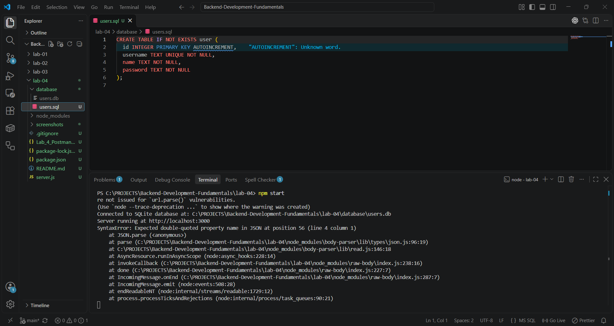
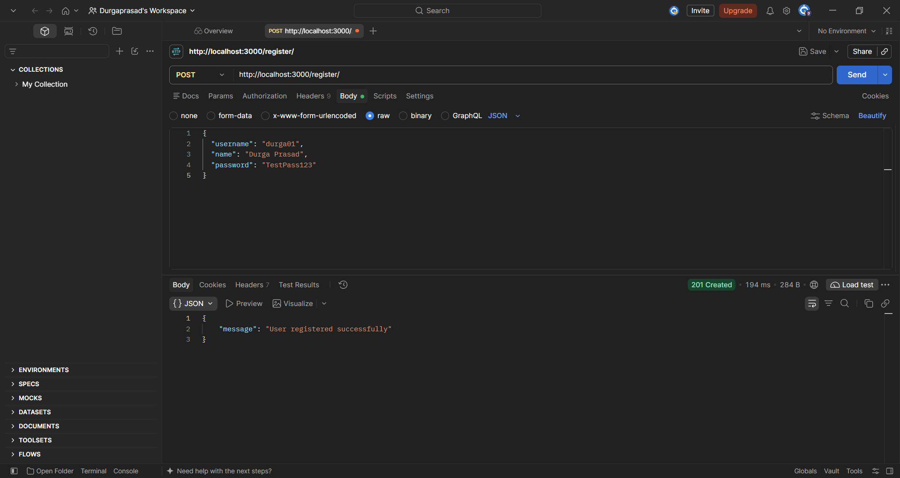
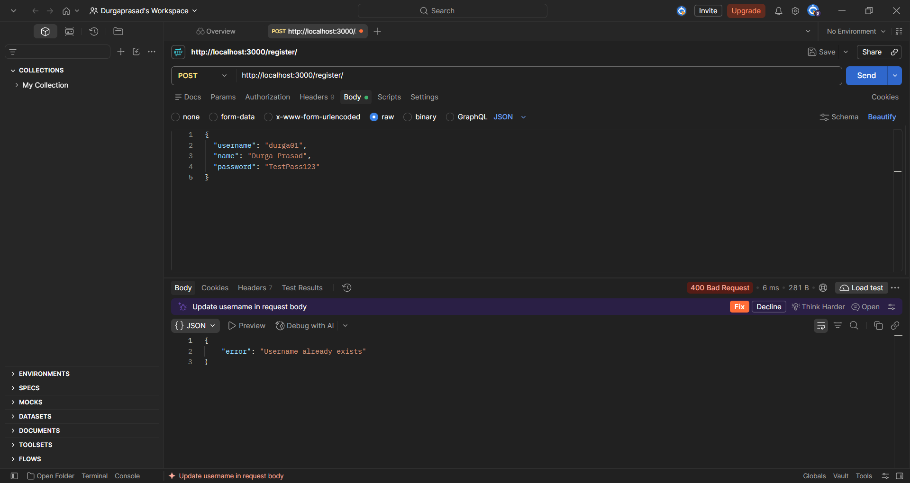
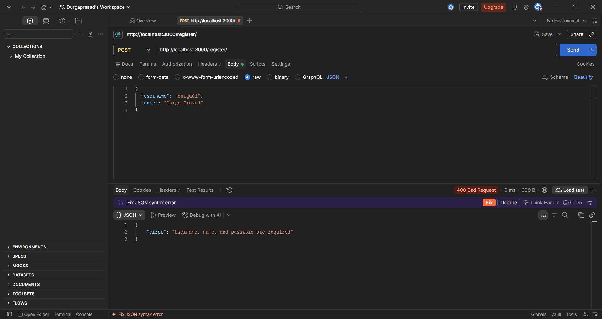
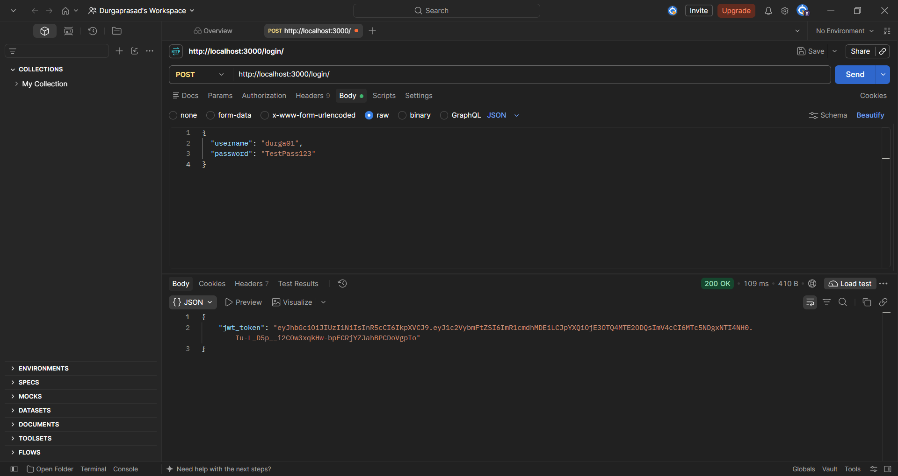
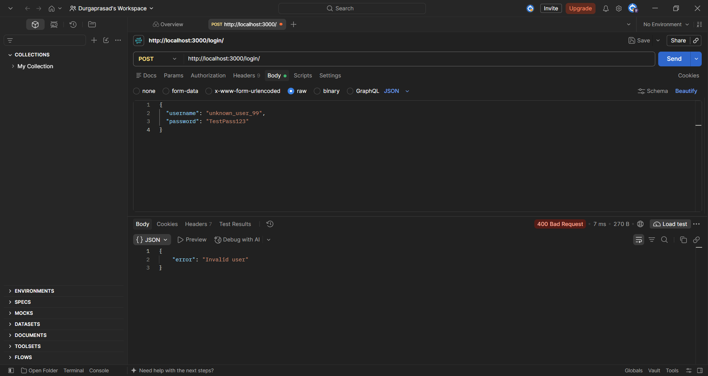
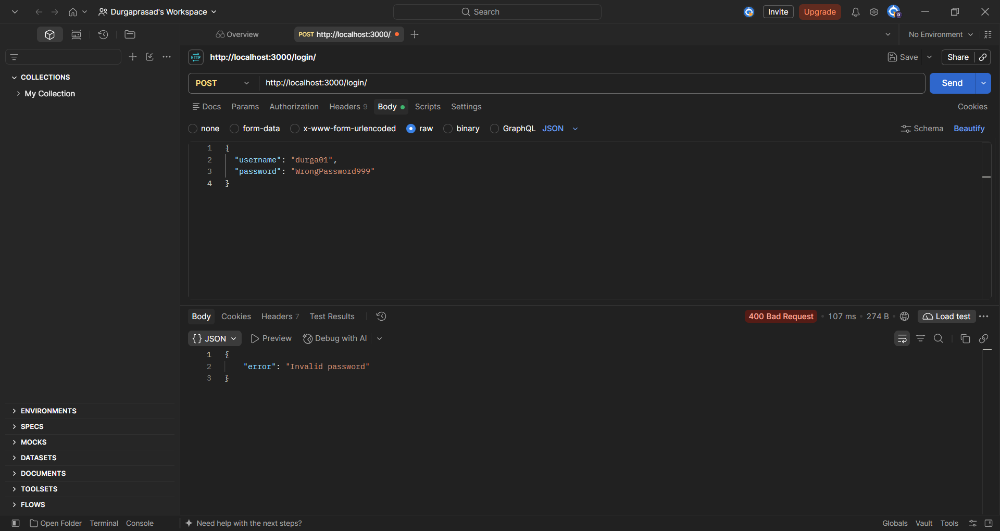
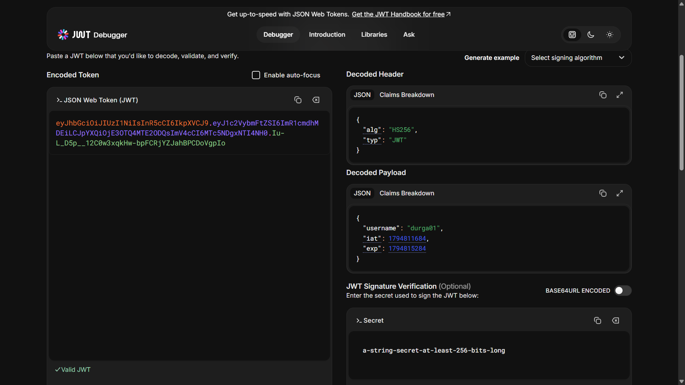
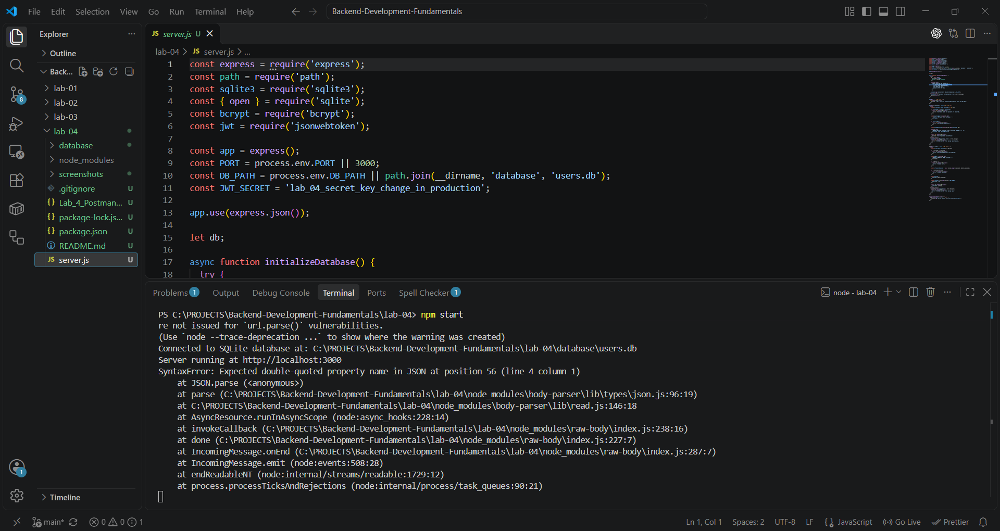
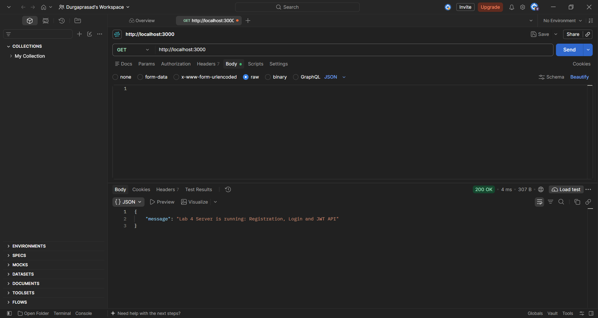

# Lab 4: Registration, Login and JWT

**Course:** Backend Development Fundamentals  
**Module:** Authentication and User Management  
**Student Name:** Jella Durga Prasad  
**Registration Number:** 252U1R6101 
**Section:** `AIML-2B/207`  
**Live Deployment URL (Render):** `https://dp-lab-04.onrender.com/`  

---

## 1. Project Introduction
This project implements user authentication in a Node.js and Express.js backend application using SQLite as the database. It covers secure user registration with password hashing via `bcrypt` and user login with token generation via `jsonwebtoken` (JWT).

## 2. Objective
- Build a REST API for user registration (`POST /register/`) and login (`POST /login/`).
- Store user details safely in a SQLite database without saving plain-text passwords.
- Hash passwords using `bcrypt.hash()` and verify them using `bcrypt.compare()`.
- Generate a signed JSON Web Token (`jwt_token`) upon successful login using `jsonwebtoken`.
- Validate input fields, reject duplicate usernames, and return proper HTTP status codes (`200`, `201`, `400`).

## 3. Technologies Used
- **Runtime:** Node.js
- **Framework:** Express.js
- **Database:** SQLite (`sqlite` and `sqlite3` packages)
- **Password Hashing:** `bcrypt`
- **Authentication Token:** `jsonwebtoken`
- **Development Utility:** `nodemon`
- **API Testing & Inspection:** Postman & [jwt.io](https://jwt.io/)

## 4. Project Folder Structure
```text
lab-04/
│
├── database/
│   ├── users.sql                      # SQL schema reference for the user table
│   └── users.db                       # Auto-generated SQLite database on server start
│
├── screenshots/                       # Submission screenshots (see Section 14)
│   ├── 01_server_running.png
│   ├── 02_register_success.png
│   ├── 03_register_duplicate.png
│   ├── 04_register_validation.png
│   ├── 05_login_success.png
│   ├── 06_login_unknown_user.png
│   ├── 07_login_wrong_password.png
│   ├── 08_database_hash.png           # TO ADD (SQLite viewer showing hashed password)
│   ├── 09_jwt_decode.png
│   ├── 10_server_code.png
│   └── 11_home_route.png
│
├── server.js                          # Main Express server and authentication routes
├── package.json                       # Project metadata, scripts, and dependencies
├── Lab_4_Postman_Collection.json      # Ready-to-import Postman test collection
├── .gitignore                         # Ignores node_modules, .env, logs, and local DB files
└── README.md                          # Complete lab documentation
```

## 5. Installation Requirements
- Windows 11
- Node.js (v18 or higher recommended) and npm
- Visual Studio Code
- Postman (Desktop App or Web Agent)

## 6. Installation Commands
Open PowerShell or the VS Code integrated terminal inside the `lab-04` directory and run:
```powershell
npm install
```
This installs `express`, `bcrypt`, `jsonwebtoken`, `sqlite`, `sqlite3`, and `nodemon`.

## 7. How to Run the Project in VS Code
1. Extract `Lab_4_Registration_Login_JWT.zip` so that the `lab-04` folder is placed inside `C:\PROJECTS\Backend-Development-Fundamentals\lab-04`.
2. Open VS Code, click **File > Open Folder**, and select `C:\PROJECTS\Backend-Development-Fundamentals\lab-04`.
3. Open the integrated terminal in VS Code (`Ctrl + ~`).
4. Run `npm install` to install dependencies.
5. Start the server:
   - Standard mode: `npm start`
   - Auto-restart development mode: `npm run dev`
6. Confirm the terminal outputs:
   ```text
   Connected to SQLite database at: C:\PROJECTS\Backend-Development-Fundamentals\lab-04\database\users.db
   Server running at http://localhost:3000
   ```

## 8. Database Explanation
When `server.js` starts, `initializeDatabase()` automatically creates `database/users.db` (if it does not already exist) and executes the table creation query defined in `database/users.sql`:

```sql
CREATE TABLE IF NOT EXISTS user (
  id INTEGER PRIMARY KEY AUTOINCREMENT,
  username TEXT UNIQUE NOT NULL,
  name TEXT NOT NULL,
  password TEXT NOT NULL
);
```

- **`id`:** Auto-incrementing primary key identifying each user.
- **`username`:** Unique text field enforced by the `UNIQUE` constraint and checked in code before insertion.
- **`name`:** Full name of the user.
- **`password`:** Stores only the 60-character `bcrypt` password hash—never the plain-text password.
- All queries use parameterized placeholders (`?`) to prevent SQL injection.

## 9. Explanation of Password Hashing (`bcrypt`)
Storing plain-text passwords is a severe security vulnerability because anyone who accesses the database file can read every user's password.

- **Hashing (`bcrypt.hash(password, 10)`):** During registration, `bcrypt` generates a random salt (cost factor `10`) and combines it with the password to produce a one-way cryptographic hash (e.g., `$2b$10$...`). Because hashing is one-way, the original password cannot be decrypted from the hash.
- **Verification (`bcrypt.compare(password, dbUser.password)`):** During login, `bcrypt` extracts the salt stored inside `dbUser.password`, hashes the newly submitted login password with that same salt, and checks whether both hashes match.

## 10. Explanation of JWT (`jsonwebtoken`)
- **What JWT Means:** JWT stands for **JSON Web Token**, a compact, URL-safe string (`header.payload.signature`) used to represent claims between a client and a server.
- **Why JWT is Used:** HTTP is stateless. Once a user logs in, the server issues a signed JWT so the client can prove its identity on future requests without re-sending its username and password every time.
- **What `jwt.sign()` Does:** `jwt.sign(payload, JWT_SECRET, { expiresIn: '1h' })` encodes the header and payload in Base64Url format and creates a cryptographic signature using `JWT_SECRET`.
- **Three Parts of a JWT:**
  1. **Header:** Specifies the token type (`JWT`) and signing algorithm (`HS256`).
  2. **Payload:** Contains the claims—in this lab, `{ "username": "durga01" }`, along with automatic timestamps (`iat` = issued at, `exp` = expiration time set to 1 hour).
  3. **Signature:** Created by hashing the encoded header + encoded payload with `JWT_SECRET`. It ensures the token has not been tampered with.
- **Why Passwords Must Never Be in the Payload:** The JWT payload is only Base64Url-encoded, **not encrypted**. Anyone with the token can decode the payload on jwt.io. Including a password or hash would expose sensitive credentials.

## 11. Complete Endpoint Documentation

### A. Home Route
- **Method & URL:** `GET http://localhost:3000/`
- **Expected Response (`200 OK`):**
```json
{
  "message": "Lab 4 Server is running: Registration, Login and JWT API"
}
```

### B. User Registration
- **Method & URL:** `POST http://localhost:3000/register/`
- **Request Body (`application/json`):**
```json
{
  "username": "durga01",
  "name": "Durga Prasad",
  "password": "TestPass123"
}
```
- **Success Response (`201 Created`):**
```json
{
  "message": "User registered successfully"
}
```
- **Error Responses (`400 Bad Request`):**
  - Missing `username`, `name`, or `password`:
    ```json
    {
      "error": "Username, name, and password are required"
    }
    ```
  - Duplicate `username`:
    ```json
    {
      "error": "Username already exists"
    }
    ```

### C. User Login
- **Method & URL:** `POST http://localhost:3000/login/`
- **Request Body (`application/json`):**
```json
{
  "username": "durga01",
  "password": "TestPass123"
}
```
- **Success Response (`200 OK`):**
```json
{
  "jwt_token": "eyJhbGciOiJIUzI1NiIsInR5cCI6IkpXVCJ9..."
}
```
- **Error Responses (`400 Bad Request`):**
  - Missing `username` or `password`:
    ```json
    {
      "error": "Username and password are required"
    }
    ```
  - Unknown `username`:
    ```json
    {
      "error": "Invalid user"
    }
    ```
  - Incorrect `password`:
    ```json
    {
      "error": "Invalid password"
    }
    ```

## 12. Postman Testing Instructions
You can either import `Lab_4_Postman_Collection.json` directly into Postman or create the requests manually:

1. **Test Registration (`POST http://localhost:3000/register/`):**
   - Open a new tab in Postman and set the method to **POST**.
   - Enter URL: `http://localhost:3000/register/`
   - Click **Body** -> select **raw** -> select **JSON** from the dropdown.
   - Paste:
     ```json
     {
       "username": "durga01",
       "name": "Durga Prasad",
       "password": "TestPass123"
     }
     ```
   - Click **Send**. Verify status is **201 Created**.
   - Click **Send** a second time with the exact same JSON to test duplicate registration. Verify status is **400 Bad Request** (`Username already exists`).
   - Remove the `"password"` field and click **Send** to test validation. Verify status is **400 Bad Request**.

2. **Test Login (`POST http://localhost:3000/login/`):**
   - Open a new tab and set the method to **POST**.
   - Enter URL: `http://localhost:3000/login/`
   - Click **Body** -> select **raw** -> select **JSON**.
   - Paste the valid credentials for `durga01` and click **Send**. Verify status is **200 OK** and copy the returned `jwt_token`.
   - Change `"username"` to `"unknown_user_99"` (keep password `TestPass123`) and click **Send**. Verify status is **400 Bad Request** (`Invalid user`).
   - Restore `"username": "durga01"`, change `"password"` to `"WrongPassword999"`, and click **Send**. Verify status is **400 Bad Request** (`Invalid password`).

> **Security Tip:** Always mask or blur the middle portion of your JWT token before sharing screenshots publicly.

## 13. jwt.io Testing Instructions
1. Copy the `jwt_token` string returned from a successful `POST /login/` response (without the quotation marks).
2. Open [https://jwt.io/](https://jwt.io/) in your browser.
3. Paste the token into the **Encoded** text box on the left.
4. Inspect the **Decoded** panels on the right:
   - **HEADER:** Displays `{"alg": "HS256", "typ": "JWT"}`.
   - **PAYLOAD:** Displays `{"username": "durga01", "iat": <timestamp>, "exp": <timestamp>}`. Confirm no password appears here.
   - *(Note: Decoding a JWT on jwt.io reads its Base64Url header and payload; signature verification requires entering your secret key in the Verify Signature box.)*

## 14. Screenshots
All screenshots are stored in `lab-04/screenshots/`.

| # | Filename | What it Shows |
|---|---|---|
| 1 | `01_server_running.png` | VS Code terminal: SQLite connected and server running on port 3000 |
| 2 | `02_register_success.png` | Postman `POST /register/` returning `201 Created` |
| 3 | `03_register_duplicate.png` | Postman `POST /register/` with duplicate username returning `400` |
| 4 | `04_register_validation.png` | Postman `POST /register/` with missing `password` returning `400` |
| 5 | `05_login_success.png` | Postman `POST /login/` returning `200 OK` and `jwt_token` |
| 6 | `06_login_unknown_user.png` | Postman `POST /login/` with unknown username returning `400` |
| 7 | `07_login_wrong_password.png` | Postman `POST /login/` with wrong password returning `400` |
| 8 | `08_database_hash.png` | SQLite viewer showing the `user` table and `$2b$10$...` hash |
| 9 | `09_jwt_decode.png` | `jwt.io` showing decoded header and payload |
| 10 | `10_server_code.png` | VS Code showing `server.js` |
| 11 | `11_home_route.png` | Postman `GET /` returning `200 OK` |

### Screenshot Gallery

**1. Server running**



**2. Register success (201)**



**3. Register duplicate (400)**



**4. Register validation (400)**



**5. Login success (200 + jwt_token)**



**6. Login unknown user (400)**



**7. Login wrong password (400)**



**8. Database hash**

*(to be added)*

**9. JWT decoded on jwt.io**



**10. Server code**



**11. Home route (200)**



## 15. Problems Faced and Solutions
1. **Native `bcrypt` Build Issues on Windows:**
   - *Problem:* Older versions of `bcrypt` sometimes fail to compile native C++ bindings on newer Node.js versions on Windows.
   - *Solution:* Used `bcrypt@^5.1.1`, which ships with prebuilt binaries for Windows, avoiding manual node-gyp compilation errors.
2. **Database File Path Across Operating Systems:**
   - *Problem:* Hardcoding Windows backslashes (`database\users.db`) breaks compatibility when deploying to Linux servers like Render.
   - *Solution:* Used `path.join(__dirname, 'database', 'users.db')` so Node.js resolves file paths cleanly on both Windows and Linux.
3. **Forgetting `express.json()` Middleware:**
   - *Problem:* Without `app.use(express.json())`, `req.body` is `undefined` on `POST` requests.
   - *Solution:* Registered `app.use(express.json())` before defining `/register/` and `/login/`.

## 16. Viva Questions and Simple Answers
1. **Q: Why do we use `bcrypt` instead of storing passwords directly or using MD5/SHA-256?**  
   **A:** Plain-text passwords are exposed if the database leaks, and fast hashes like MD5/SHA-256 can be cracked quickly using rainbow tables or GPUs. `bcrypt` adds a random salt and is intentionally slow (configurable via salt rounds), making brute-force attacks impractical.
2. **Q: What does the `10` in `bcrypt.hash(password, 10)` represent?**  
   **A:** It is the salt rounds (cost factor), meaning `bcrypt` runs $2^{10}$ (1,024) key-expansion iterations to generate the hash.
3. **Q: Why did we return HTTP `201` for registration and HTTP `200` for login?**  
   **A:** HTTP `201 Created` indicates a new user resource was created in the database, whereas HTTP `200 OK` indicates the login request succeeded and returned a token without creating a new database record.
4. **Q: What are the three parts of a JWT?**  
   **A:** Header (algorithm and token type), Payload (user claims like `username` and expiration `exp`), and Signature (cryptographic verification hash).
5. **Q: Can anyone read the payload of a JWT?**  
   **A:** Yes. The payload is Base64Url-encoded, not encrypted. That is why we only store `username` in the payload and never include the password.
6. **Q: Why do we use `await` with `db.get()`, `db.run()`, `bcrypt.hash()`, and `bcrypt.compare()`?**  
   **A:** Database queries and bcrypt hashing are asynchronous operations that return Promises. Using `async/await` ensures each step completes before moving to the next line of code.

## 17. Conclusion
In this lab, we built a secure authentication backend using Node.js, Express, SQLite, `bcrypt`, and `jsonwebtoken`. We verified user registration, duplicate prevention, password hashing, credential verification, and JWT issuance using Postman and `jwt.io`.